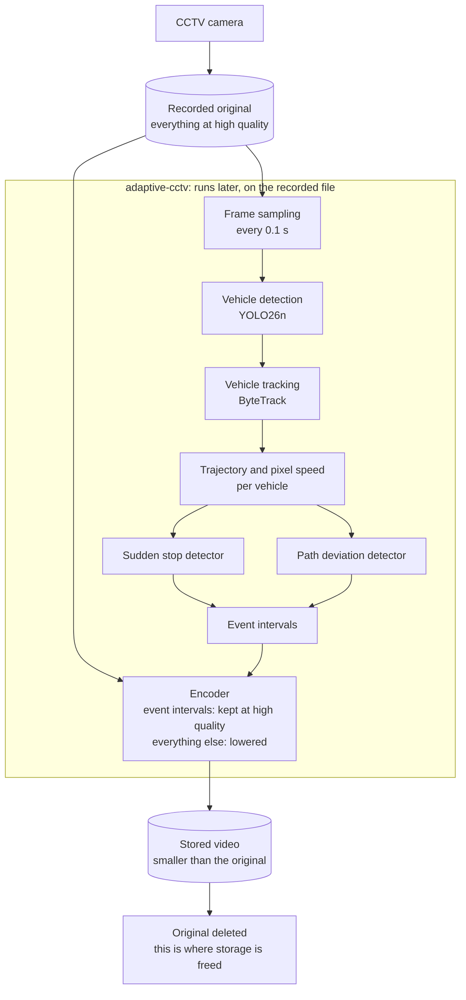

# adaptive-cctv

Importance-based differential storage for fixed traffic CCTV.

CCTV records every scene at the same high quality, so storage fills quickly and footage
cannot be kept for as long as it should be. adaptive-cctv detects abnormal driving in the
video and stores only those segments at high quality. Normal segments are stored at low
quality, which cuts the total storage needed.

This is a university capstone project (2026 fall semester).

## How it works



How to read it:

- **The starting point is a recording that already exists.** The camera has stored everything
  at high quality; adaptive-cctv processes that file afterwards. It is post-processing, not
  something that happens while recording.
- **Nothing is made better.** "High quality" means an event interval is left as recorded.
  "Low quality" means everything else is reduced. Storage is saved only by lowering the
  parts that are not events.
- **Events are judged on the original.** Detection and tracking read the recorded file
  before any quality is lowered, so how hard the rest is compressed does not affect what
  gets detected.
- **Space is freed when the original is deleted.** Until then both files exist.

Real-time and on-camera operation are future work. There, the decision has to be made while
video is still arriving, so recent footage must be held back for a few seconds before it is
stored.

## Status

Tracking, the sudden-stop detector, and a path-deviation draft are in the repository as
separate modules. They are not connected into one pipeline yet, and the encoder is not
written.

## Setup

```bash
python3 -m venv .venv
.venv/bin/pip install -r requirements.txt
```

## Usage

Run from the repository root. Videos are not included in the repository; pass the path to
your own file.

```bash
# Print each vehicle's recent positions and pixel speed, in 5-second chunks
.venv/bin/python -m adaptive_cctv.tracking <video>

# Write a copy of the video with boxes, track ids, and paths, plus a CSV of positions
.venv/bin/python -m scripts.visualize <video> [--output OUT.mp4] [--csv OUT.csv] [--focus-id ID]
```

The first run downloads the `yolo26n.pt` weights into the working directory.

## Contributing

Commits follow [Conventional Commits](https://www.conventionalcommits.org/), for example
`feat(events): add sudden stop detector`. Pull requests are pre-filled from
`.github/PULL_REQUEST_TEMPLATE.md`.

## Documentation

- [docs/DESIGN.md](docs/DESIGN.md): decisions, module interfaces, event definitions,
  datasets, and evaluation.
- [MEMORY.md](MEMORY.md): progress log of changes and decisions, newest first.
- [AGENTS.md](AGENTS.md): working rules for coding agents.
