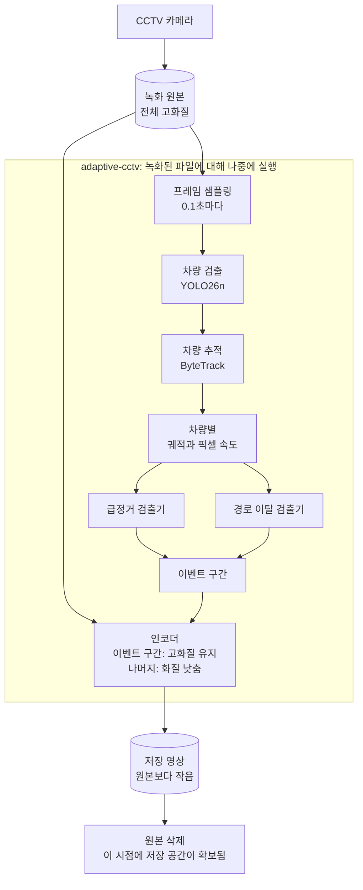

# adaptive-cctv

[English](README.md) | 한국어

고정형 교통 CCTV를 위한 중요도 기반 차등 저장.

CCTV는 모든 장면을 같은 고화질로 녹화하기 때문에 저장 공간이 빨리 차고, 영상을 필요한 만큼
오래 보관하지 못한다. adaptive-cctv는 영상에서 이상 주행을 검출하고 해당 구간만 고화질로
저장한다. 정상 구간은 저화질로 저장해 전체 저장 용량을 줄인다.

대학교 캡스톤 프로젝트다(2026년 2학기).

## 동작 방식



읽는 법:

- **출발점은 이미 존재하는 녹화본이다.** 카메라가 전체를 고화질로 저장해 두었고,
  adaptive-cctv는 그 파일을 나중에 처리한다. 녹화 중에 일어나는 일이 아니라 후처리다.
- **화질을 높이는 부분은 없다.** "고화질"은 이벤트 구간을 녹화된 그대로 둔다는 뜻이고,
  "저화질"은 나머지를 낮춘다는 뜻이다. 저장 공간은 이벤트가 아닌 부분을 낮춰서만 절약된다.
- **이벤트는 원본에서 판단한다.** 검출과 추적은 화질을 낮추기 전의 녹화 파일을 읽으므로,
  나머지 구간을 얼마나 강하게 압축하든 검출 결과에는 영향이 없다.
- **공간은 원본을 삭제할 때 확보된다.** 그 전까지는 두 파일이 모두 존재한다.

실시간 동작과 카메라 내 동작은 향후 과제다. 그 경우에는 영상이 들어오는 도중에 판단해야
하므로, 최근 영상을 저장하기 전에 몇 초간 보류해야 한다.

## 현황

추적, 급정거 검출기, 경로 이탈 초안이 각각 별도 모듈로 저장소에 있다. 아직 하나의
파이프라인으로 연결되지 않았고, 인코더는 작성되지 않았다.

## 설치

```bash
python3 -m venv .venv
.venv/bin/pip install -r requirements.txt
```

## 사용법

저장소 루트에서 실행한다. 영상은 저장소에 포함되어 있지 않으니 직접 가진 파일의 경로를
넘긴다.

```bash
# 차량별 최근 위치와 픽셀 속도를 5초 단위로 출력
.venv/bin/python -m adaptive_cctv.tracking <video>

# 박스, 트랙 ID, 경로를 그린 영상 사본과 위치 CSV를 저장
.venv/bin/python -m scripts.visualize <video> [--output OUT.mp4] [--csv OUT.csv] [--focus-id ID]
```

처음 실행하면 `yolo26n.pt` 가중치를 작업 디렉터리에 내려받는다.

## 기여

커밋은 [Conventional Commits](https://www.conventionalcommits.org/)를 따른다. 예:
`feat(events): add sudden stop detector`. Pull request는
`.github/PULL_REQUEST_TEMPLATE.md`로 미리 채워진다.

## 문서

- [docs/DESIGN.md](docs/DESIGN.md): 결정 사항, 모듈 인터페이스, 이벤트 정의, 데이터셋, 평가.
- [MEMORY.md](MEMORY.md): 변경과 결정의 진행 기록, 최신순.
- [AGENTS.md](AGENTS.md): 코딩 에이전트용 작업 규칙.

이 문서는 [README.md](README.md)의 번역본이다. 내용이 다르면 영어 원문이 우선한다.
